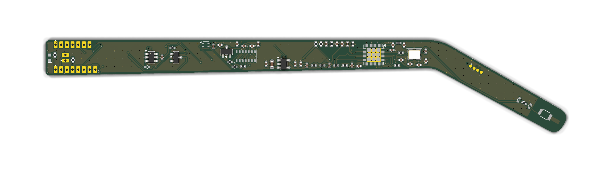
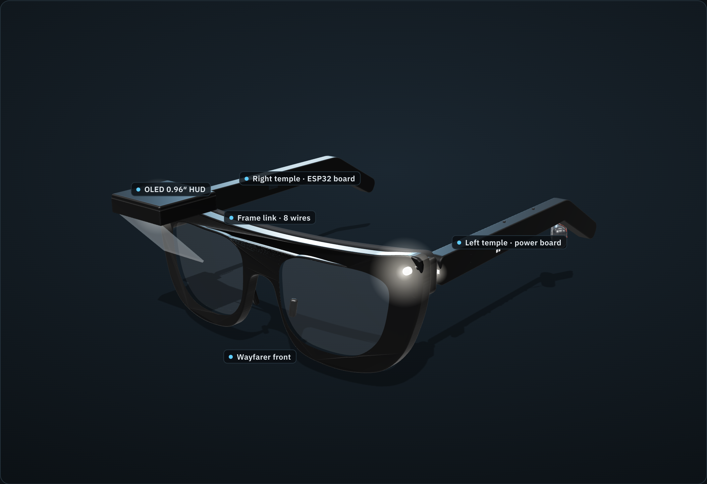
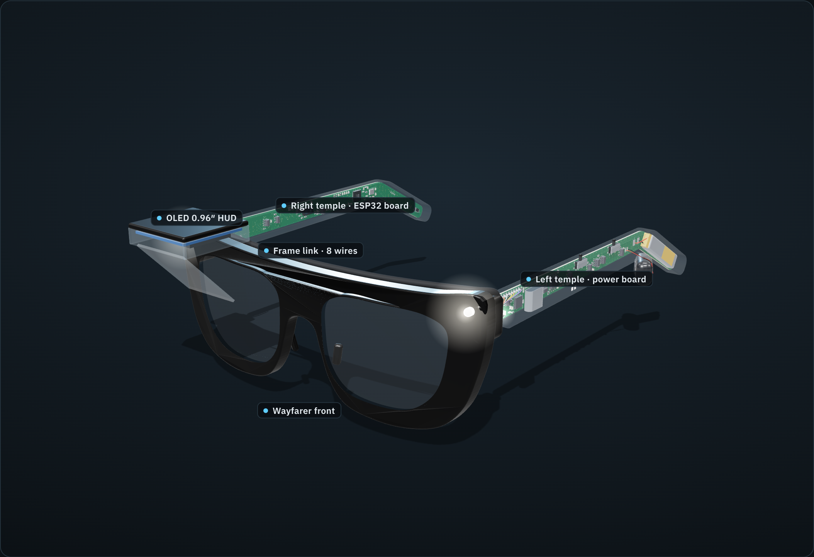
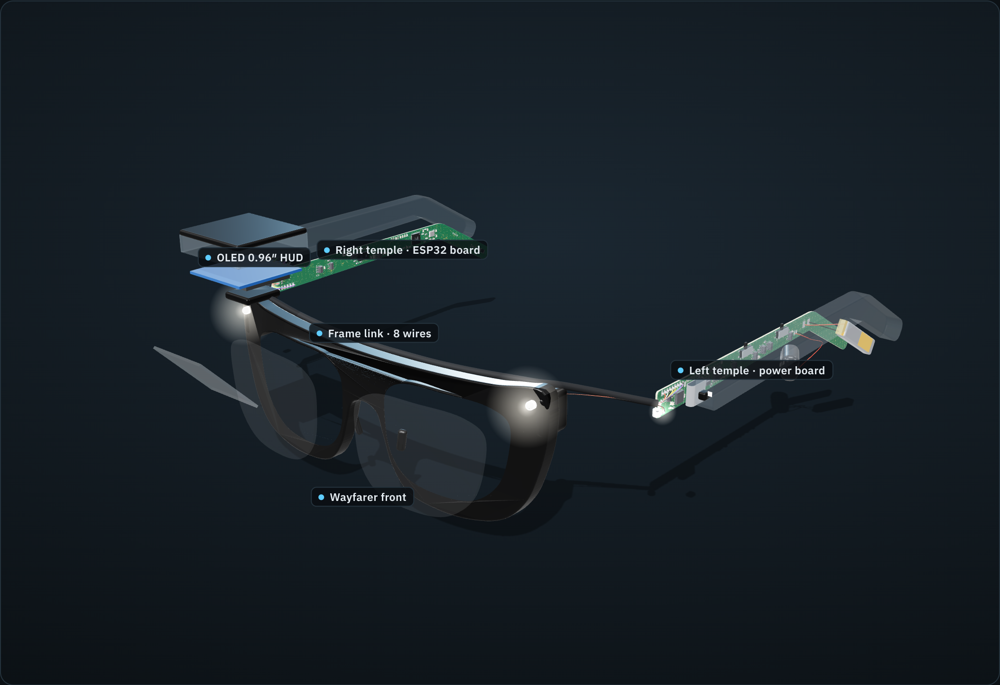
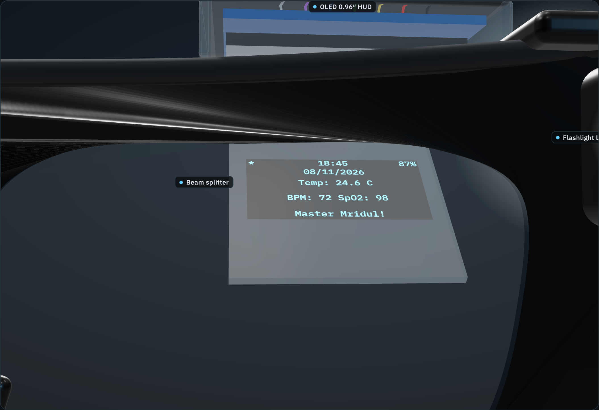
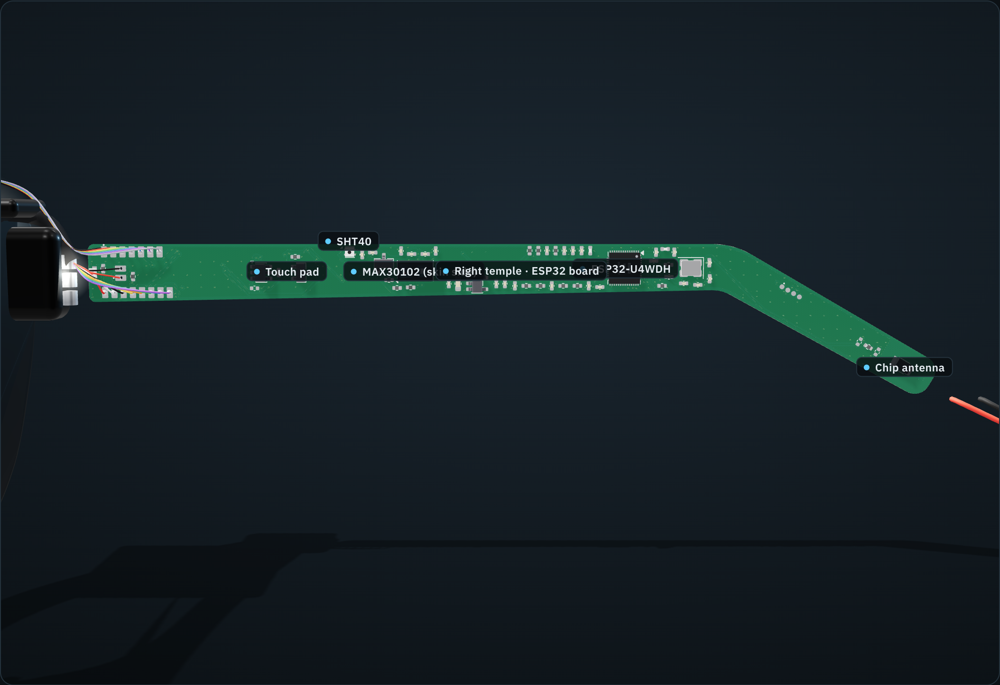
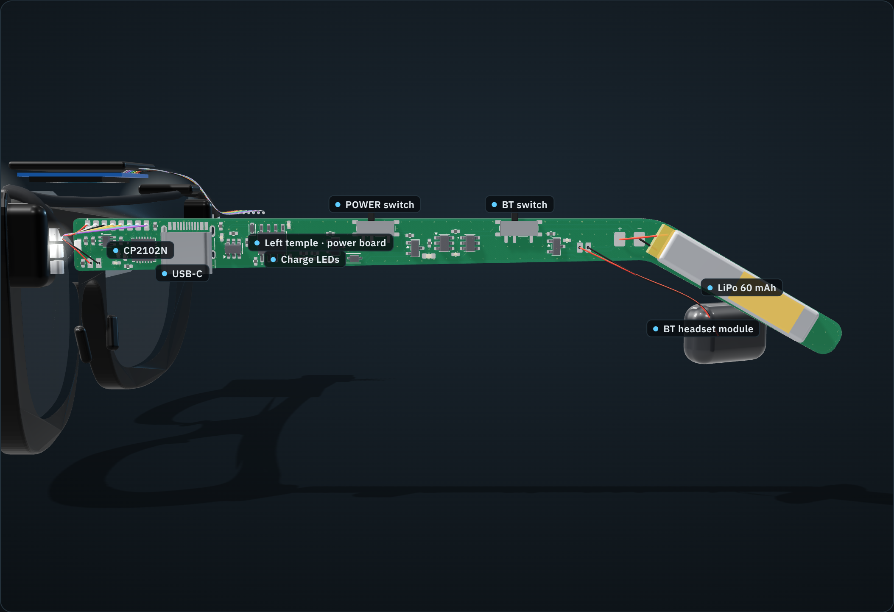

# ANA V1 temple PCBs

Two KiCad 9 boards that replace the hand-wired V1 modules. Each board is cut in the shape of a glasses
temple (straight, then bending 30° down behind the ear) so it slides into a temple cover. Every part is
soldered directly to the board: the ESP32 chip itself, the sensor chips, the charger and the USB-C socket.

| | Right temple: `ana-main` | Left temple: `ana-power` |
|---|---|---|
| Job | ESP32 + sensors + display link | Battery, charging, power switching |
| Main parts | ESP32-U4WDH (5×5 mm, 4 MB flash in package), 2.4 GHz chip antenna, MAX30102, SHT40, TTP223 touch, 3.3 V and 1.8 V LDOs, side LED, bring-up pads | USB-C (bottom edge), CP2102N USB-serial + DTR/RTS auto-reset, TP4056 charger, DW01A + FS8205A cell protection, USB/battery power path, POWER and BT slide switches, BT-headset power pads, side LED, battery pads |
| Parts | 63: 55 assembled by JLCPCB, 3 tuning parts not fitted, 5 wire/touch/test pads | 48: 44 assembled by JLCPCB, 4 wire/battery pads |




## 3D model of the finished glasses

`3d/index.html` is an interactive model of the whole pair: wayfarer front, hinges, lenses, the OLED pod with its
45° beam splitter, both temple covers, the two real boards with every part fitted, the LiPo, the frame-link and OLED
wiring, the flashlight LEDs and a placeholder for your Bluetooth headset module. Hover any part for its value and
job, switch the covers between solid, see-through and off, explode it, or look through the right lens at the HUD.
It also lists every feature and the weight breakdown (about 43 g as worn, 37–48 g depending on frame and lens
material, without the Bluetooth module).

```bash
python3 -m http.server -d hardware/3d 8000
```

Then open http://localhost:8000 (browsers will not load the models from a `file://` page). After changing a
board, rebuild the board models and part data with `/usr/bin/python3 hardware/3d/make_assembly.py`.








## Shape and size

The outline comes from [`config/temple.json`](config/temple.json): the inside of the temple cover minus
0.3 mm per side (0.5 mm at the ends). Both temples use the same outline: on the right temple the
components face the head; on the left temple they face outwards.

| Cover inside (your input) | Value | PCB |
|---|---|---|
| A straight length, hinge → bend | 105 mm | 104.5 mm |
| B ear-tip length | 40 mm | 39.5 mm |
| θ bend angle | 30° | 30° |
| H1 / H2 / H3 height at hinge / bend / tip | 10 / 8 / 7 mm | 9.4 / 7.4 / 6.4 mm |
| T thickness | 5 mm | 0.8 mm board + max 1.55 mm part (right), 3.3 mm USB-C (left) |

These are the "typical slim temple" numbers you picked. **Measure your real cover and change
`config/temple.json`**, then rebuild (below). [`docs/temple-outline-dimensions.svg`](docs/temple-outline-dimensions.svg)
is a dimensioned drawing with the positions of every window and slot your cover needs; print it 1:1 to check the fit.

Cover openings needed (x measured from the hinge end along the top edge):

- Right temple, head side: MAX30102 window at x ≈ 50–56 mm (must touch skin); SHT40 vent at x ≈ 41–44 mm top edge.
  Touch area on the outer face at x ≈ 26.5–36.5 mm (10 × 4 mm electrode; touch through ≤ 2 mm of plastic).
  Side LED and the two wire bundles leave at the hinge end.
- Left temple: USB-C opening in the bottom edge at x ≈ 16–25 mm; POWER switch lever (top edge, x ≈ 54 mm);
  BT switch lever (top edge, x ≈ 79.5 mm); charge LEDs red/green at x ≈ 40–43 mm.
- The LiPo (≈ 3.5 × 7 × 30 mm, ~60 mAh) sits in the left ear tip; no parts are placed there.

## Layer stack

Both boards are 4-layer, 0.8 mm FR-4 with all parts on the top layer.

| Layer | `ana-main` (right) | `ana-power` (left) |
|---|---|---|
| F.Cu (top) | parts, short links and cross-board hops, RF feed, GND pour | parts, signals, GND pour |
| In1.Cu | solid GND plane (RF reference) | solid GND plane |
| In2.Cu | long signals running along the temple, 3.3 V pour in the free space | signals + GND pour |
| B.Cu (bottom) | long signals running along the temple, touch electrode, GND pour | signals + GND pour |

The ESP32 pins escape through a fixed pattern of short stubs and vias in up to three staggered rows, so
none of its 0.35 mm-pitch pins is boxed in. Its footprint has no bottom-side copper pad (the 16 thermal vias
still tie the exposed pad to the In1 ground plane), so tracks can also pass under the chip. The CP2102N on
the left temple uses the same kind of footprint (9 thermal vias). On the right
temple the long lines run lengthwise on In2 and B.Cu and cross the board on F.Cu, so no track walls off
another; 3.3 V is routed as a net (0.3 mm where it fits) and backed by the 3.3 V pour on In2. Nothing runs
under the touch electrode except its own pad.

## Wiring between the boards

Two thin wire bundles run over the front frame, as in V1:

**Frame link, 8 wires, same pad order on both temples** (pads J1 on the right, J3 on the left):

| Pad | 1 | 2 | 3 | 4 | 5 | 6 | 7 | 8 |
|---|---|---|---|---|---|---|---|---|
| Signal | VSYS | LED_K | GND | EN | IO0 | CHRG | ESP32 RX | ESP32 TX |

All wire pads are plated holes (0.6 mm drill, 1.5 mm pitch): push the stripped wire through and solder. Use flexible
wire (e.g. 32–34 AWG silicone); VSYS and GND carry the whole right temple's current, so use your thickest wire for those
two. USB itself stays on the left temple: the CP2102N there turns it into the ESP32's serial port (RX, TX) and drives
EN/IO0 for automatic flashing, so those four lines are what crosses the frame.

**OLED module, 7 wires** (pads J4 on the right temple, same order as the module's header):
GND, VCC (3.3 V), D0/CLK, D1/MOSI, RES, DC, CS.

Other pads: `EXT_LED` (+/−, optional brighter LED at the frame corner, 68 Ω already on board),
`BT_HEADSET` (+/− switched battery for your Bluetooth headset module), battery `+`/`−`, and on the right
temple four bring-up pads `3V3 GND TX RX` on the ear tip just behind the bend (TX is the ESP32's TX after its
470 Ω series resistor). EN and IO0 are on frame-link pads 4 and 5, so the right temple can also be flashed on its
own from the frame-link pads: 3.6–5 V on VSYS, a 3.3 V USB-serial adapter on RX/TX, and IO0 held to GND while EN is
pulsed low to enter the bootloader.

## What changed from the V1 wiring, and why

| Change | Reason |
|---|---|
| ESP32-U4WDH bare chip instead of the WROOM module | The WROOM is 18 mm wide, taller than the temple. U4WDH is the same dual-core 240 MHz ESP32 with Bluetooth Classic (needed by `SerialBT`) and 4 MB flash inside. Its crystal, RF match and antenna are on the board, following Espressif's reference design. |
| New pin map: OLED CLK/MOSI/CS/DC/RST = 4/23/15/26/27, I²C unchanged (21/22) | U4WDH uses GPIO16/17 for its in-package flash, and on a 7.7 mm-tall board each chip edge can only escape a few signals, so pins were picked by which edge of the chip faces where they go. The firmware has `#define ANA_TEMPLE_PCB 1` with the new pins. |
| SHT40 instead of DHT11 | DHT11 is 12 × 15.5 × 5.5 mm and does not fit a 5 mm temple; SHT40 is 1.5 mm, ±0.2 °C, on the same I²C bus. It sits at the top edge, about 20 mm from the regulator and 45 mm from the ESP32, with no copper pour around it. |
| USB-C flashing (CP2102N + DTR/RTS auto-reset, on the left temple) | Plug in and upload like a devkit; no external programmer. The CP2102N sits next to the USB-C socket, so USB never crosses the frame: only RX, TX, EN and IO0 do. It has its own regulator fed from VSYS, so it is on only while the glasses are on and never back-powers the ESP32. |
| TP4056 + DW01A/FS8205A + power path | Like a protected TP4056 module, but the glasses run from USB while charging so the charger terminates correctly. |
| POWER and BT slide switches (switching MOSFET gates) | The tiny switches only carry gate current; the FETs carry the load. The BT headset is fed from the protected cell directly, never from 5 V. |
| Battery %, USB and charging status to the ESP32 | Shown in the top corner of the HUD. USB is detected from the battery-voltage divider: with USB plugged in, VSYS sits at about 4.6 V (5 V minus a Schottky diode), above any LiPo voltage. The charge-status line has a diode so nothing back-powers the ESP32 when it is off. |
| Touch also read by the ESP32 (GPIO14) | TTP223 is still in toggle mode and switches both temples' LEDs through one MOSFET, like V1; the firmware shows `*` while the light is on. |
| CAP2 RC (3.3 nF ∥ 20 kΩ) left out, only the 10 nF on CAP1 fitted | Espressif marks the RC as optional when deep sleep is not used (it only shortens the deep-sleep transition). Frees space beside the chip. Add it back if you add deep sleep. |
| MAX30102 on the inner face, 1.8 V core LDO on board | Hands-free reading at the temple; I²C is 6 V tolerant so it runs straight from the 3.3 V pull-ups. |

## Checks run on this design

| Check | `ana-main` | `ana-power` |
|---|---|---|
| ERC (`kicad-cli sch erc`) | 0 | 0 |
| Schematic netlist vs `circuits.py` (every pin of every net) | identical | identical |
| DRC (`kicad-cli pcb drc`) errors | 0 | 0 |
| DRC warnings | 1: a 0.08 mm-wide neck in the top-layer ground pour at crystal pad 4 (ground only) | 0 |
| Unconnected items | 0 | 0 |
| Schematic ↔ PCB parity | 0 | 0 |

The reports are in `ana-main/drc.json`, `ana-main/erc.json`, etc. The design rules are JLCPCB's
4-layer limits with margin: 0.1 mm track and space, 0.4/0.2 mm vias, 0.25 mm copper-to-edge.

Not verifiable here, so please check them yourself:

- **RF tuning.** The antenna network (C15/L2/C16 near the chip, C17/R8/C18 near the antenna) uses
  Espressif's starting values. For best range, tune it with a VNA, or at least compare RSSI with your
  phone at a few distances. Keep wires and metal at least 5 mm from the antenna in the ear tip.
- **Fit.** The outline is from typical dimensions until you measure your cover.
- **Firmware.** It was edited carefully but not compiled here (no ESP32 toolchain in this environment).
  Compile it in the Arduino IDE first.

## Ordering at JLCPCB

`fab/<board>/` holds everything needed:

- `<board>-gerbers-jlcpcb.zip`: upload as the PCB. Choose 4 layers, **0.8 mm thickness**, and the standard
  JLC04081H stack-up (impedance control is not required). Any colour.
- `<board>-BOM-jlcpcb.csv` and `<board>-CPL-jlcpcb.csv`: upload for PCBA, top side only. Every part number
  was checked as in stock on 2026-11-07. In the PCBA preview, check the rotation of the ESP32 (pin-1 dot),
  CP2102N, MAX30102, TP4056, the side LEDs (light must point out of the hinge edge) and the USB-C.
- `<board>-BOM-full.csv`: every part, including what you solder yourself (wire pads, battery) and the
  not-fitted RF/touch tuning parts.

## First power-up

1. Inspect the boards and connect the 8-wire frame link, then the OLED. Leave the battery off.
2. Plug USB-C into the left temple with POWER off: the red LED lights (charging), or with no battery the green
   one (the red may flicker), and nothing on the right temple is powered.
3. POWER on: check 3.3 V on the right temple's bring-up pads (`3V3` to `GND`) and 1.8 V across C29 next to the
   MAX30102. The ESP32 shows up as a CP2102N serial port; upload `prototype_toy_.ino` with the Arduino IDE.
4. Solder the battery (red to `+`), then unplug USB and check the HUD shows a battery %.
5. Optional, recommended: burn the flash-voltage eFuse once with `espefuse.py set_flash_voltage 3.3V`, so
   GPIO12 can never select the wrong flash voltage.

## Regenerating

Everything here is generated from Python, so edit the sources, not the KiCad files:

```bash
/usr/bin/python3 hardware/scripts/build.py
```

```bash
/usr/bin/python3 hardware/scripts/export.py
```

- `scripts/circuits.py`: parts, values, LCSC numbers, nets (the single source of truth)
- `config/temple.json`: temple dimensions; `scripts/layouts.py`: part placement
- `scripts/build.py`: schematic → board → routing (`scripts/router.py`, a grid router written for this
  project) → copper pours → ERC/DRC/parity reports
- `scripts/export.py`: Gerbers, drill, BOM/CPL, PDFs, 3D renders, outline drawing

The boards also open normally in KiCad 9 if you want to adjust things by hand (custom symbols and
footprints are in `lib/`).
