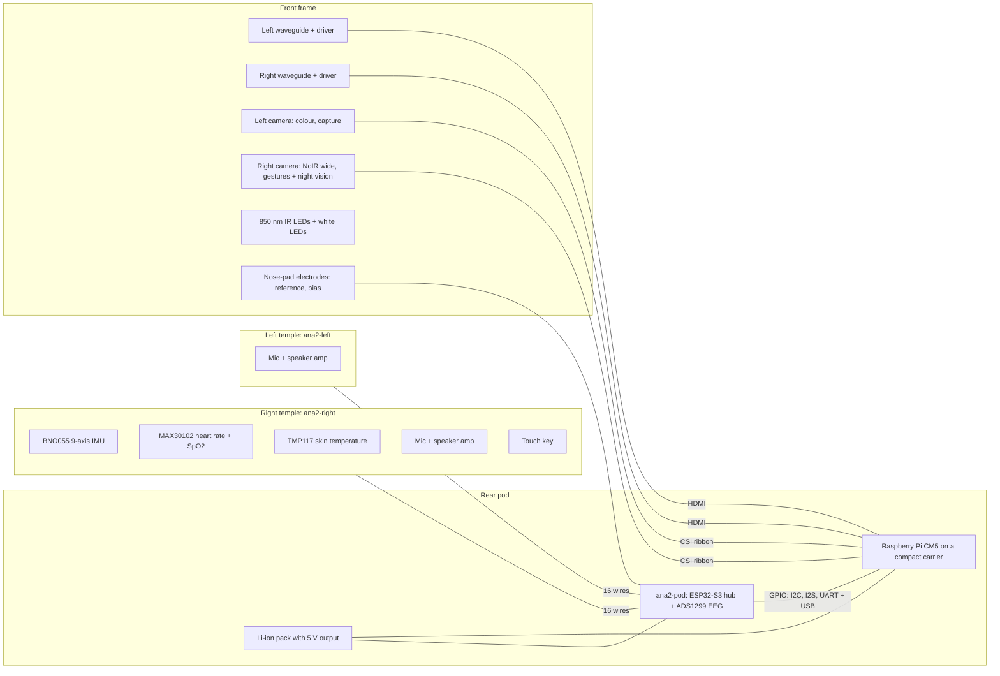
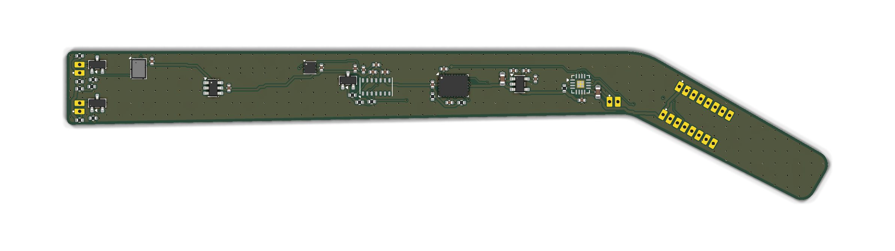
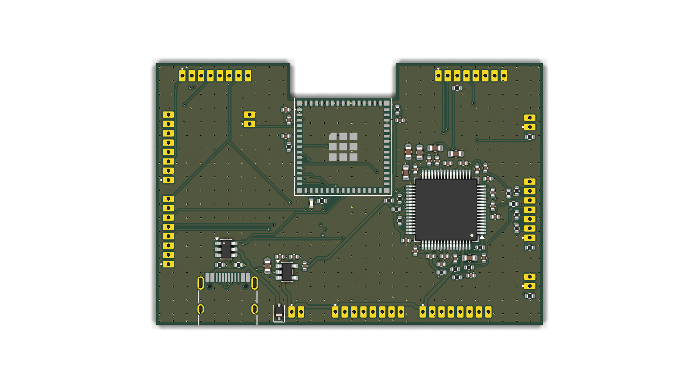

# ANA V2 hardware (design stage, not built yet)

V2 moves the glasses from a microcontroller HUD to a wearable Linux computer: binocular waveguide displays, two
cameras, hand-gesture control, on-device speech and small language models, and a full sensor set.
V1.1 (`hardware/ana-main`, `hardware/ana-power`) is untouched; everything for V2 lives in this folder.

**Status:** the three custom boards below are designed, routed and pass the automatic checks. Nothing has been
manufactured or tested. Read "Not verified" before ordering.

## Why a Raspberry Pi and not a Teensy or Portenta

MediaPipe hand tracking, three.js rendering in a browser, speech recognition and language models need a 64-bit
Linux computer with a GPU and gigabytes of RAM. A Teensy 4.1 or Portenta H7 is a microcontroller: about 1 MB of
RAM, no GPU, no browser. The Raspberry Pi Compute Module 5 (4 × Cortex-A76, up to 16 GB RAM, Wi-Fi 5,
Bluetooth 5, 2 camera ports, 2 HDMI outputs) is the strongest module a single builder can buy, solder to nothing
and get software support for. It is 55 × 40 mm, so it cannot go inside a temple: it sits with the battery in a pod
at the back of the head, on a strap between the two ear tips. That also balances the weight of the displays.

## System



| Function | How | Bought or custom |
|---|---|---|
| Compute, Wi-Fi, Bluetooth, storage | Raspberry Pi CM5, 8 GB RAM / 32 GB eMMC, wireless (16 GB / 64 GB for larger models) | bought |
| Carrier for the CM5 | any compact CM5 carrier with 2 CSI camera ports, 2 HDMI (or HDMI + DSI), USB and the 40-pin GPIO signals | bought |
| Displays | 2 waveguide modules with their driver boards, HDMI input | bought (not chosen yet, see below) |
| Cameras | 2 Raspberry Pi-compatible CSI cameras on long ribbons: colour autofocus (capture) and NoIR wide-angle (gestures, night vision) | bought |
| Night vision | 2 × 850 nm IR LEDs per side, PWM-dimmed from the Pi; seen by the NoIR camera, shown in the displays | custom boards + LEDs |
| Head tracking | BNO055, 9-axis with on-chip fusion | `ana2-right` |
| Heart rate, SpO₂, skin temperature | MAX30102, TMP117 (±0.1 °C) | `ana2-right` |
| Voice in / audio out | 2 I²S MEMS microphones (one per side), 2 I²S class-D amplifiers for small speakers by the ears; Bluetooth audio also works | both temple boards |
| Touch | TTP223 key on the right temple | `ana2-right` |
| EEG | ADS1299-4, 4 channels, dry electrodes at both ear tips and both temples, reference and bias on the nose pads | `ana2-pod` |
| Always-on hub | ESP32-S3: power button, battery level, EEG stream over USB, BLE while the Pi is off | `ana2-pod` |
| Power | Li-ion pack with a 5 V / 5 A output and USB-C charging | bought |

## The three custom boards

All are 4-layer, 0.8 mm, parts on one side, JLCPCB-assembled. Every assembled part has an LCSC number that was in
stock on 2026-11-11.

| | `ana2-right` | `ana2-left` | `ana2-pod` |
|---|---|---|---|
| Shape | temple, 104.5 + 39.5 mm, 13.4 → 9.4 mm tall | same outline | 62 × 42 mm, antenna notch |
| Parts | 46 (40 assembled) | 25 (20 assembled) | 74 (63 assembled) |
| Unrouted / unconnected | 0 / 0 | 0 / 0 | 0 / 0 |
| DRC errors | 0 | 0 | 0 |
| DRC warnings | 1 (narrow neck in a ground pour) | 1 (0.3 mm ground stub at the microphone) | 0 |
| ERC | 1 warning (amplifier pad pin type) | 1 warning (same) | 1 warning (pin type on an unused input) |
| Schematic ↔ board | match | match | match |





The V2 temple cover is taller and thicker than V1 (inside 14 / 12 / 10 mm tall, 7 mm thick, in
`config/temple.json`), because the 11.5 mm camera ribbon and the display cable run behind the board.

## Wiring

**Each temple to the pod: two rows of 8 wires, same pad order at both ends** (J1 and J2 on the temple; J1/J2 for
the right and J3/J4 for the left on the pod).

| Pad | 1 | 2 | 3 | 4 | 5 | 6 | 7 | 8 |
|---|---|---|---|---|---|---|---|---|
| Row A | 5V | GND | SDA | SCL | IMU_INT | PPG_INT | TOUCH | IR_PWM |
| Row B | 5V | GND | I2S_BCLK | I2S_LRCLK | MIC_SD | SPK_SD | GND | LED_PWM |

The left temple uses only 5V, GND, IR_PWM and row B.

**Pod to the Raspberry Pi GPIO** (J5, J6):

| Pad | 1 | 2 | 3 | 4 | 5 | 6 | 7 | 8 |
|---|---|---|---|---|---|---|---|---|
| J5 | SDA · GPIO2 | SCL · GPIO3 | IMU_INT · GPIO4 | PPG_INT · GPIO5 | TOUCH · GPIO17 | IR_PWM · GPIO12 | LED_PWM · GPIO13 | GND |
| J6 | BCLK · GPIO18 | LRCLK · GPIO19 | MIC_SD · GPIO20 | SPK_SD · GPIO21 | hub TX → GPIO15 | hub RX ← GPIO14 | PI_SHDN · GPIO6 | GND |

Other pod pads: J7 5 V in from the pack, J8 USB-C (hub to a Pi USB port, or to a PC for flashing), J9 BOOT,
J10 electrodes (1 left ear tip, 2 right ear tip, 3 left temple, 4 right temple, 5 reference, 6 bias, 7 shield),
J11 power button, J12 cell voltage sense and pack enable.

I²C addresses: BNO055 0x28, MAX30102 0x57, TMP117 0x48.

## Software plan

Raspberry Pi OS 64-bit, booting straight into a full-screen Chromium window that runs GestureHolo (MediaPipe
Tasks Vision + three.js) on the gesture camera and spans both displays. Sensors arrive over I²C; audio over I²S
(the `googlevoicehat-soundcard` overlay drives a MAX98357A and an I²S microphone together and is the starting
point). `llama.cpp` with a 1–4 B-parameter quantised model, `whisper.cpp` and Piper run as local services, as in
the V2 notes in the root README. None of this software is written or tested in this repository yet.

Expect, as rough figures to measure rather than promises: hand tracking at 15–30 frames/s, simple three.js scenes
at 30–60 frames/s, a few tokens per second from a 3–4 B model, and not all three at full speed at once.

## Budgets (estimates)

| | Estimate |
|---|---|
| Power | 3 W idle, 6–9 W with camera, tracking and rendering running |
| Run time | about 1.5–2 hours from a 12 Wh (3000 mAh) pack |
| Heat | the CM5 needs a metal heat spreader as the outer face of the pod, away from the head |
| Weight | roughly 180–220 g on the head, about half of it in the rear pod |

## Not verified

- **Displays.** No waveguide module is chosen. The design assumes each comes with a driver board that takes HDMI
  and 5 V. Pick the modules first; they set the frame shape and the front of the temples.
- **Carrier and cables.** The CM5 carrier, camera ribbons (200–300 mm) and HDMI cables are off-the-shelf parts
  that still have to be chosen and fitted. Hinges cannot fold with ribbons through them unless a slack loop is
  designed in.
- **Pin details.** The ADS1299 wiring was checked against its datasheet (bypass values, unused pins, bias
  feedback). The BNO055, MAX98357A, ICS-43434 and TMP117 wiring follows the KiCad library pin maps but was not
  checked against their datasheets here. Check each before ordering.
- **EEG quality.** Dry electrodes on a moving head are noisy. The analog supply is the 5 V rail through an RC
  filter, so EEG is only in specification on battery power (not from USB through the diode). This is not a medical
  device; use it on battery only.
- **IR safety.** 850 nm LEDs are invisible but not harmless. Keep the drive at the designed 80 mA with diffuse
  wide-angle LEDs and do not use lensed high-power emitters.
- **Thermal, RF, audio levels, battery protection.** Not simulated or measured.

## Regenerating

```bash
/usr/bin/python3 hardware/v2/scripts/v2.py
```

`scripts/v2.py` holds the parts, nets and placement of all three boards and uses the V1 generator in
`hardware/scripts` as a library. Outputs: `ana2-*/` (KiCad projects, `drc.json`, `erc.json`), `fab/` (Gerbers,
BOM, pick-and-place), `docs/` (schematic PDFs, renders).
